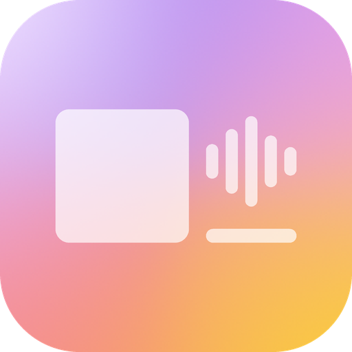

<p align="center"><strong>English</strong> · <a href="README.zh-CN.md">简体中文</a></p>

<div align="center">
  
  <h1>HyperImmersive</h1>
  <p><strong>Lay a charging HyperOS 4 phone on its side, and the lock screen becomes an iPhone-style StandBy.</strong></p>
  <p>
    <a href="https://github.com/Lewewe/HyperImmersive/releases"></a>
    <a href="https://t.me/HyperMusicCoverEnhanced"></a>
    <a href="https://t.me/HyperMusicCoverEnhancedChannel"></a>
    <a href="LICENSE"></a>
  </p>
</div>

> [!IMPORTANT]
> You need **[HyperMusicCover-Enhanced](https://github.com/Lewewe/HyperMusicCover-Enhanced)** to use HyperImmersive. It has no settings screen of its own. You change everything from HyperMusicCover-Enhanced, which also supplies the lyrics, the visualizer and the lock screen backdrop. If HyperMusicCover-Enhanced isn't installed, or isn't signed with the same key as HyperImmersive, StandBy won't start.

## Features

| | |
| --- | --- |
| 🌙 **StandBy** | Comes up over the lock screen when you charge the phone on its side |
| 🧩 **Widgets** | Clocks, a calendar and more, arranged in pages and stacks you edit right on the screen |
| 🎵 **Music page** | Cover art and playback controls, plus the lyrics and visualizer from HyperMusicCover-Enhanced |
| 🖼️ **Artwork background** | The current song's cover, blurred, sits behind everything |
| 🔋 **Status at a glance** | Battery, Wi-Fi and signal fold into one small glyph |
| 🛌 **Rest & sleep** | Dims when nobody touches it for a while, and can then turn the screen off |
| 🚫 **No system gestures** | LSPosed keeps the system bars and edge swipes from getting in the way |

## Install

**Requires:** rooted HyperOS 4 (Android 15+), LSPosed and HyperMusicCover-Enhanced newer than v1.0.1.

1. In HyperMusicCover-Enhanced, open **Extensions → HyperImmersive → Download**.
2. Tap **Request hook permissions** and enable HyperImmersive in LSPosed with System UI in its scope.
3. Tap **Restart hooks to finish setup**.
4. Open **HyperImmersive** and tap **Grant permissions (root)**.
5. Lock the phone, plug it in and lay it on its side. To see it right away, tap **Preview StandBy** instead.

There's no launcher icon. Every setting, **Uninstall HyperImmersive** included, is in HyperMusicCover-Enhanced.

## Build

```sh
./gradlew assembleRelease
```

You'll need Android SDK 37. Sign the APK with the key HyperMusicCover-Enhanced uses (`keystore.properties`). With a different key the two apps can't talk to each other, and StandBy won't start. If that file is missing, the build falls back to the debug key.

## Status

Alpha. It's been tested on a Xiaomi 17 Pro, so other phones may behave differently.

## Credits

- [Lewewe](https://github.com/Lewewe): development
- [miuix](https://github.com/compose-miuix-ui/miuix): the back and settings icons (Apache-2.0)

License: [AGPL-3.0](LICENSE)
