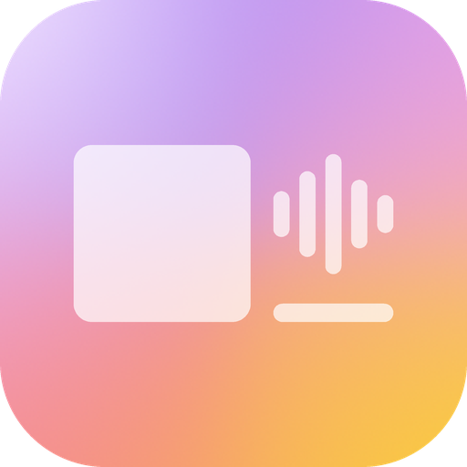

<p align="center"><a href="README.md">English</a> · <strong>简体中文</strong></p>

<div align="center">
  
  <h1>HyperImmersive</h1>
  <p><strong>手机横放充电时，HyperOS 4 锁屏就变成 iPhone 风格的待机显示（StandBy）。</strong></p>
  <p>
    <a href="https://github.com/Lewewe/HyperImmersive/releases"></a>
    <a href="https://t.me/HyperMusicCoverEnhanced"></a>
    <a href="https://t.me/HyperMusicCoverEnhancedChannel"></a>
    <a href="LICENSE"></a>
  </p>
</div>

> [!IMPORTANT]
> 使用 HyperImmersive 必须先安装 **[HyperMusicCover-Enhanced](https://github.com/Lewewe/HyperMusicCover-Enhanced)**。它没有自己的设置界面，所有设置都在 HyperMusicCover-Enhanced 里调整，歌词、可视化和锁屏背景也由它提供。如果没装 HyperMusicCover-Enhanced，或者两者签名密钥不同，StandBy 就不会启动。

## 功能

| | |
| --- | --- |
| 🌙 **StandBy** | 手机横放充电时，出现在锁屏之上 |
| 🧩 **小组件** | 时钟、日历等，按页面和堆叠排列，直接在屏幕上编辑 |
| 🎵 **音乐页** | 封面和播放控制，外加来自 HyperMusicCover-Enhanced 的歌词与可视化 |
| 🖼️ **封面背景** | 当前歌曲的封面模糊后铺在背后 |
| 🔋 **状态一览** | 电量、Wi-Fi 和信号收进一个小图标 |
| 🛌 **休息与息屏** | 一段时间没人碰就会变暗，之后还能关闭屏幕 |
| 🚫 **屏蔽系统手势** | 借助 LSPosed，系统栏和边缘手势不会来打扰 |

## 安装

**需要：** 已 root 的 HyperOS 4（Android 15+）、LSPosed，以及高于 v1.0.1 的 HyperMusicCover-Enhanced。

1. 在 HyperMusicCover-Enhanced 中打开 **Extensions → HyperImmersive → Download**。
2. 点击 **Request hook permissions**，在 LSPosed 中启用 HyperImmersive，作用域包含系统界面。
3. 点击 **Restart hooks to finish setup**。
4. 打开 **HyperImmersive**，点击 **Grant permissions (root)**。
5. 锁屏后插上充电器，把手机横放。想马上看效果，也可以点击 **Preview StandBy**。

应用没有桌面图标。所有设置都在 HyperMusicCover-Enhanced 里，**Uninstall HyperImmersive** 也在那儿。

## 构建

```sh
./gradlew assembleRelease
```

需要 Android SDK 37。APK 要用 HyperMusicCover-Enhanced 的密钥签名（`keystore.properties`）。密钥不同的话，两个应用之间无法通信，StandBy 也不会启动。缺少这个文件时，构建会改用调试密钥。

## 状态

Alpha 阶段。目前只在小米 17 Pro 上测试过，其他手机可能会有差异。

## 致谢

- [Lewewe](https://github.com/Lewewe)：开发
- [miuix](https://github.com/compose-miuix-ui/miuix)：返回和设置图标（Apache-2.0）

许可证：[AGPL-3.0](LICENSE)
